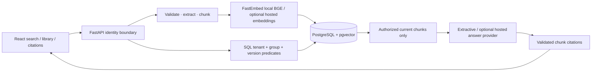

# ContextMesh architecture

## Identity and retrieval

Server configuration maps bearer credentials to immutable tenant, user, role and groups. API bodies cannot override that mapping. `retrieval.access()` builds the SQL predicate: matching tenant AND (owner OR overlapping groups OR tenant admin). That same boundary applies to listing, downloads, citation lookups and search. Admin access never bypasses the tenant predicate. Query schemas forbid extra identity fields.

pgvector computes cosine distance in PostgreSQL. SQL joins filter accessible documents, current chunk versions, ready index state and matching embedding provider before returning candidates. The answer provider receives only these returned rows. This is exact vector search, not an approximate index; suitable for the small fixture corpus, not a claimed billion-vector deployment. RLS is not enabled: the application SQL boundary is tested, and database credentials are trusted infrastructure. Production deployments should add RLS as defense in depth.

## Ingestion and stale data

Uploads are bounded to 8 MiB, DOCX decompression to 32 MiB, PDFs to 200 pages and extracted text to 500,000 characters. Files reside in PostgreSQL byte storage, avoiding filesystem traversal and partial file/database commits. Scanned PDFs without text are explicitly rejected; OCR is not claimed. Words are chunked into 180-word windows with 30-word overlap. Ingestion records status/error for parser or embedding failures.

Updates lock the document row, increment its version and replace chunks in one transaction. If reindexing fails, the document is marked error and old chunks are excluded by status/version predicates. Citation URLs for deleted/superseded chunks return 404. Updating permissions immediately affects later SQL reads, including citation views and downloads. Already-returned text cannot be revoked from a client.

## AI adapters

The standard local embedding provider is FastEmbed's open-source `BAAI/bge-small-en-v1.5` (384 dimensions); it downloads public weights on first use and runs ONNX inference locally. `hash` is a deliberately labeled deterministic lexical baseline for isolated tests, not a substitute semantic model. The optional OpenAI embedding adapter requests 384-dimensional vectors. Documents carry a provider identifier so incompatible spaces are never mixed; changing provider requires reindexing. Production should also track immutable model revisions and normalization versions.

The default answer provider quotes authorized excerpts and cites actual chunks. It does not claim generative reasoning. Optional hosted answers request typed JSON and validate every returned chunk ID against retrieved context; missing or fabricated references fail closed. Document text is explicitly untrusted data in hosted prompts. This reduces injection risk but does not establish perfect model factuality.

## Evaluation and operation

Thirty synthetic documents across three tenants yield 300 queries: direct and paraphrased retrieval, summaries, detail queries, group denial, cross-tenant denial, instruction attacks, stale-version checks and unindexed-source uncertainty. Every document is first seeded with obsolete text and updated before evaluation. Metrics include recall, precision, MRR, citation validity, authorization and stale-context violations. Unknown-source uncertainty cases intentionally use metadata filtering; these do not establish calibrated open-domain abstention. Hosted-generation evaluation is separate and not run without credentials.

Ingestion is synchronous; large models/documents occupy a request worker. Deploy a durable ingestion queue before high throughput. Development authentication uses shared identities. Schema creation is initial-only SQLAlchemy metadata, not an upgrade migration framework. All data is synthetic and access events record chunk IDs, not query bodies. Rate limits are per identity/process. See verification and deployment notes in README.
