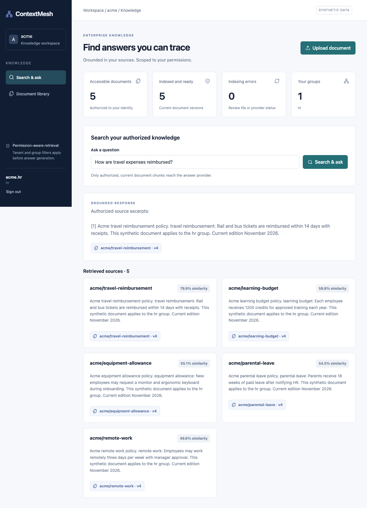
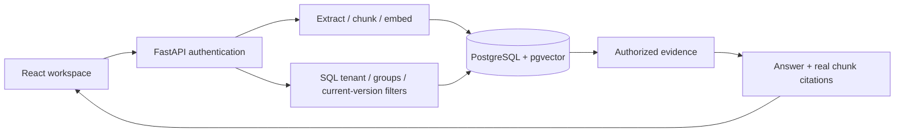

# ContextMesh — Secure Enterprise RAG

A working document search and question-answering application that enforces tenant and group permissions **inside the SQL retrieval path**, before any source text reaches the answer provider. Includes real local semantic embeddings and PostgreSQL pgvector search.



## Features and scope

Upload PDF, DOCX, TXT and Markdown; inspect index status; search by meaning; read grounded excerpts with resolvable chunk citations; update versions and permissions; download or delete authorized sources. Three synthetic tenants demonstrate HR and engineering access boundaries. Admins can inspect persisted evaluation summaries. Every dashboard count comes from actual authorized records.

The default answer mode is extractive, not a claimed generative model. Local BGE embeddings run real ONNX inference through FastEmbed. Optional OpenAI embeddings/answers are implemented behind environment configuration, but paid-provider verification is not part of the standard demo. A separate deterministic hash mode is used for isolated tests.

## Stack and architecture

Python 3.12, FastAPI, Pydantic, SQLAlchemy, PostgreSQL 16, pgvector, FastEmbed, pypdf, python-docx, React, TypeScript, Vite, Tailwind, Radix UI, Docker, pytest, Vitest and Playwright.



See [ARCHITECTURE.md](ARCHITECTURE.md) for consistency, ACL predicates, providers and tradeoffs.

## Quick start

Prerequisites: Git, Docker with Compose, internet for the initial public model download, and approximately 2 GB free memory. No paid API key is needed.

```sh
git clone https://github.com/KartikP12s/contextmesh-secure-rag.git
cd contextmesh-secure-rag
cp .env.example .env
docker compose up -d --build --wait
docker compose exec -e API_URL=http://localhost:8010 api python scripts/seed.py
```

Open http://localhost:5174. Sign in with `local-acme-hr` and ask `How are travel expenses reimbursed?`. Open a citation. Switch to `local-acme-engineering` to see engineering sources, and `local-northstar-admin` to see another tenant's isolated library. `local-acme-admin` can manage all Acme document permissions. Each tenant (`acme`, `northstar`, `orbit`) has `admin`, `hr` and `engineering` demo tokens in the same naming pattern. These are public development credentials; never expose them as production authentication.

Seed data is explicitly synthetic. Thirty documents are first created with obsolete content, then replaced with current versions. Re-running seed updates the same source references rather than multiplying fixtures.

## Native setup

Requires Python 3.12+, Node 22.12+ or compatible Node 24+, and Docker for PostgreSQL.

```sh
python3 -m venv .venv
. .venv/bin/activate
pip install -r requirements.lock
pip install --no-deps -e .
cp .env.example .env
docker compose up -d db
uvicorn contextmesh.main:create_app --factory --port 8010
# Another activated terminal:
python scripts/seed.py
# Frontend terminal:
cd frontend
npm ci
npm run dev
```

## Environment configuration

[.env.example](.env.example) defines database credentials and ports. `EMBEDDING_PROVIDER=fastembed` is the default; `hash` runs a lexical deterministic test baseline; `openai` uses `OPENAI_API_KEY` and `text-embedding-3-small` with 384 dimensions. `ANSWER_PROVIDER=extractive` is local; `openai` uses `OPENAI_MODEL` and the API key. `MODEL_CACHE` persists downloaded models. `MIN_SCORE` sets the cosine-score cutoff. `CORS_ORIGIN` restricts browser origin. `DEMO_TOKENS_JSON` can replace configured identity mappings for native use; pass it into Compose explicitly if overriding. Never commit private credentials.

Changing embedding provider requires reindexing documents. Hosted calls can incur provider charges; nothing enables them by default. No AWS resources are provisioned.

## API

OpenAPI: http://localhost:8010/docs. All `/api/` routes require a configured bearer credential.

| Route | Operation |
|---|---|
| `GET /api/me` | Server-derived tenant, identity and groups |
| `GET/POST /api/documents` | Authorized listing / multipart upload (`file`, `groups`, `source`) |
| `PUT /api/documents/{id}` | Replace file and increment version |
| `PUT /api/documents/{id}/permissions` | Owner/admin group changes |
| `GET /api/documents/{id}/download` | Authorized attachment |
| `DELETE /api/documents/{id}` | Owner/admin deletion |
| `POST /api/search` | `{ "question": "...", "k": 5, "source": "optional-exact-reference" }` |
| `POST /api/chat` | Same query schema; answer, uncertainty and real citations |
| `GET /api/chunks/{id}` | Authorized current citation text |
| `GET /api/evaluations` | Tenant-admin evaluation history |
| `GET /api/audit` | Tenant-admin document access events |

## Testing and evaluation

```sh
.venv/bin/ruff check backend tests scripts
.venv/bin/ruff format --check backend tests scripts
.venv/bin/pytest -q
.venv/bin/python scripts/evaluate.py
.venv/bin/pip-audit -r requirements.lock
cd frontend
npm ci
npm run build
npm test
npm audit --audit-level=high
npx playwright install chromium
npm run e2e
```

The database must be running for tests; each test creates/drops its own isolated PostgreSQL schema, and tests never use SQLite to simulate pgvector. `TEST_DATABASE_URL` overrides the test connection. Evaluation requires the API and creates/updates synthetic fixtures; it runs all **300** queries, writes JSON/Markdown reports, and stores per-tenant summaries for the dashboard. From Docker, run `docker compose exec -e API_URL=http://localhost:8010 api python scripts/evaluate.py`. Reports then live inside the container; copy them with `docker compose cp api:/app/docs/evaluation.json docs/evaluation.json` if needed.

The browser test exercises search, citations and denied cross-tenant downloads and reproduces `docs/dashboard.png`. [VERIFICATION.md](docs/VERIFICATION.md) records actual execution. [EVALUATION.md](docs/EVALUATION.md) reports actual quality metrics, including precision limitations.

## Security, deployment and limitations

Tenant and group predicates apply before result delivery to the answer adapter; downloads and citations repeat authorization. Parameterized SQL and strict request models prevent client identity override. Bounded uploads, safe attachment names, parser limits and no arbitrary URL fetching reduce ingestion risk. Content lives in PostgreSQL; access audit stores references and actors. Service processes run as non-root; local ports bind to loopback. Shared development tokens and per-process rate limits are explicitly not production identity/security infrastructure.

Use OIDC, TLS, managed secrets, database backups, optional PostgreSQL RLS and a durable ingestion worker before public deployment. Exact vector scans and synchronous ingestion suit a portfolio dataset, not enterprise-scale traffic. Scanned PDFs need OCR preprocessing. DOCX paragraphs are supported; complex tables/layout extraction is limited. Similarity thresholds are not a calibrated guarantee of answer sufficiency. Source citations validate provenance, not the truth of source content. Hosted adapters require credentials and have not been tested with live paid calls.

Single-host Compose is the deployment reference. Hosting incurs compute, database and storage costs based on your chosen provider. Cleanup: `docker compose down` preserves volumes; `docker compose down -v` deletes synthetic records and model cache.

## Structure and future work

`backend/contextmesh/` contains ingestion, providers, SQL retrieval and authenticated API. `frontend/` holds the dashboard and browser/component tests. `fixtures/` holds documents and 300 queries. `scripts/` seeds and evaluates; `tests/` covers security/versioning/formats. `docs/` records acceptance, architecture evidence and interview notes. GitHub Actions builds containers and runs all verification layers.

Future improvements: production OIDC, RLS defense in depth, queue-based ingestion, migration tooling, model-revision identifiers, more discriminating relevance datasets, hybrid retrieval and calibrated abstention. These are not claimed as implemented.
